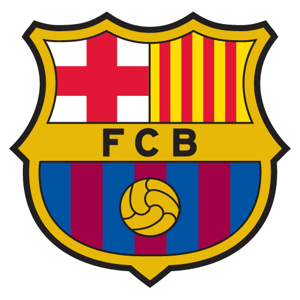

# FC Barcelona Team Summary

Built full-stack web systems to display player profiles (photos, age, nationality, and stats) in a clean UI, dynamically categorizing players by their field positions.

## Challenge

Using computer programming and other DevOps tools to gather domain specific data, cleaning, structuring, storing and displaying it with the help of web based tools and specific database tools.

## Approach

1. Looked for websites that host the specific information I am looking for
2. Downloading and extracting the relevant information
3. Using the Python programming language to clean, structure, storing the data in databases
4. Build a a web based user interface
5. Giving users the ability to sign up and create accounts(with usernames and passwords)
6. Storing passwords as hashes instead of their plain text values
7. Give admin users the ability to edit their list of players(deleting and adding)
8. Adding login and logout features
9. Giving all logged in users the ability to leave comments on a player's picture

## Tools Used

- PHP
- HTML
- CSS
- Git
- GitHub
- SQL
- MySQL
- XAAMP
- Google Cloud Platform(for future app expansion)
- OWASP Top 10 Cybersecurity framework

## Key Findings

Was able to display and categorize all 26 players and gave users the ability to create accounts, login and logout, make comments on players. Was able to see a list of users in the database and delete some of them with my admin privileges.

## What I Learned

Software Engineering principles, Agile methodologies, Data analysis, information security, hashing, and Web development.

## Screenshots

## References

- [Xaamp](https://www.apachefriends.org/download.html)
- [https://owasp.org/projects/top-ten]
- [https://cloud.google.com/]
